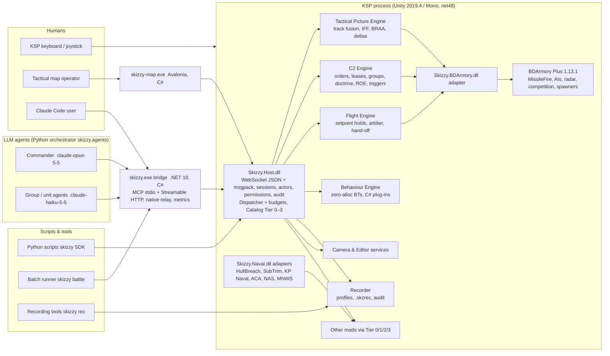

# skizzy-protocol design — 00 Overview

**Status:** design pass 1.1 (review pass, 2026-11-08; see `19-review.md` for the traceability matrix, corrections and verified claims). Pass 1.0 was 2026-11-08. **No code exists yet**: every component below is to be built. Supersedes `PLAN.md` v0.2 and `PROTOCOL-SPEC-DRAFT.md` 0.2 where they conflict; `IDEAS.md` wins over both. Everything below was checked against the BDArmory fork at `D:\KerbalSpaceProgram\BDArmory\BDArmory` (branch `multitarget-1.13.1`, HEAD `ff5130c19`), the installed GameData (84 mod folders) and the patched naval sources under `_downloads\patched\`.

**What this is.** skizzy-protocol is a command-and-control (C2) and automation platform for KSP 1.12.5 + BDArmory Plus 1.13.1. Humans, scripts and LLM agents design warships, spawn fleets, fly, fight, watch and analyse 100–1000-vessel naval and air battles through one API with one permission model. BDArmory's own AI stays the physics-rate combat autopilot; everything else layers on top of it.

**Principle: an optional layer, zero cost when unused** (IDEAS constraint, added 2026-11-08). Plain BDArmory guard mode works exactly as it does today with nothing connected: no LLM, no bridge, no map and no script is required for anything BDArmory already does. Everything skizzy-protocol adds is an optional layer on top. With nothing connected (no session, no log or recording running, no lease, no hold) the host's per-frame cost is zero in practice: the dispatcher is disabled, engines are idle because nothing is subscribed, no `OnFlyByWire` callback is registered, no Harmony patch is applied, and the fork hooks are null delegates behind one branch (`02-architecture.md` §8, gate "< 0.1 ms/frame, 0 B/frame"). Removing the plugin folder leaves the game and the user's saves unchanged (`20-runtime-lifecycle.md` §5).

## 1. Vision in one page

```
   intent ─────────────▶ orders ─────────────▶ behaviours ─────────────▶ steering/weapons
   (human, Opus)          (C2 engine)           (BDA AI, holds, BTs,         (FlightCtrlState,
   seconds–minutes        0.1–1 s               Python scripts)              MissileFire)
                                                20 ms–100 ms                 20 ms
   ◀────────────── tactical picture: tracks, events, deltas, BRAA ──────────────┘
```

Four layers, each at its own rate, each a first-class actor:

| Layer                   | Actor kinds                                             | Loop rate               | Where it runs                                     |
| ----------------------- | ------------------------------------------------------- | ----------------------- | ------------------------------------------------- |
| Steering & fire control | BDArmory AI, Skizzy setpoint holds, SubTrim depth       | 50 Hz (physics)         | in-game, `OnFlyByWire`                          |
| Behaviours              | Behaviour trees (in-game), C# plug-ins, Python scripts  | 5–50 Hz                | in-game BT engine; scripts over the binary socket |
| Tactics                 | Fast LLM per unit/group (`claude-haiku-5-5`), scripts | 0.2–2 Hz, event-driven | external orchestrator                             |
| Command                 | Human, strong LLM (`claude-opus-5-5`), tactical map   | minutes, event-driven   | human UI, external orchestrator                   |

Everything is reachable from four front ends that share one catalog: **scripts** (Python first, C# second), **LLM agents** (MCP), **the tactical map** (desktop app with APP-6/2525 symbology) and **in-game controls** (IMGUI windows, action groups, hotkeys).

## 2. Architecture



Process boundary: only `Skizzy.Host.dll`, `Skizzy.BDArmory.dll`, `Skizzy.Naval.dll` and `Skizzy.Protocol.dll` run inside KSP. They target **net48** and are compiled against KSP's own `KSP_x64_Data/Managed` assemblies (KSP ships no `netstandard.dll`, so a netstandard2.0 build of `Skizzy.Protocol` must not be loaded in-game; the out-of-game copy is a separate build of the same sources). The bridge, the map, the orchestrator, scripts and tooling run outside and talk to the host over a loopback WebSocket.

## 3. Actor model

Every connection declares an **actor**. Actors own leases, issue orders, consume budgets and appear in the audit log.

```json
{ "actor": { "id": "a:cmdr-1", "kind": "llm", "role": "commander", "model": "claude-opus-5-5",
             "parent": null, "display": "CDR Opus" } }
```

| `actor.kind` / role      | Examples                                                                                | Default precedence | ROLE `maxPrecedence` |
| -------------------------- | --------------------------------------------------------------------------------------- | ------------------ | ---------------------- |
| `human`                  | the KSP pilot, the map operator, the Claude Code user                                   | 1000               | 1000                   |
| `llm` role `commander` | Opus commander                                                                          | 800                | 800                    |
| `llm` role `group`     | AD coordinator, strike lead, ASW screen                                                 | 700                | 700                    |
| `llm` role `unit`      | Haiku unit agents                                                                       | 600                | 600                    |
| `script`                 | Python swarm controller, batch runner                                                   | 400                | 500                    |
| `behaviour`              | in-game behaviour trees, C# plug-ins                                                    | 300                | 400                    |
| `harness`                | test harness, FakeKsp conformance runner                                                | 400                | 500                    |
| (`bda`)                  | BDArmory's own AI and guard mode (implicit, never connects, not a valid `actor.kind`) | 0                  | —                     |

**[REVIEW]** `actor.kind` is one of `human | llm | script | behaviour | harness`. The *client* (the process holding the socket) is separate: `client.kind` is one of `map | bridge | orchestrator | sdk | cli`. Precedence is a number, not a hard-coded order, so a doctrine file can promote a trusted script above unit agents, but the effective precedence is always `min(doctrine value, ROLE maxPrecedence)` from the permission file (`15-security-permissions.md` §2). A client may lower its own precedence, never raise it. Conflicts are resolved by **leases on control channels** (`09-c2-multi-agent.md` §4). The KSP pilot touching the stick is an implicit human lease on the `steer` channel of the active vessel.

## 4. Key decisions (the hard calls)

| #   | Decision                                                                                                                                                                                                                                                                                                                                                 | Why (short)                                                                                                                                                                                                                                                                                                                                                                                                                                                                                                                             | Rejected                                                                                                                      |
| --- | -------------------------------------------------------------------------------------------------------------------------------------------------------------------------------------------------------------------------------------------------------------------------------------------------------------------------------------------------------- | --------------------------------------------------------------------------------------------------------------------------------------------------------------------------------------------------------------------------------------------------------------------------------------------------------------------------------------------------------------------------------------------------------------------------------------------------------------------------------------------------------------------------------------- | ----------------------------------------------------------------------------------------------------------------------------- |
| D1  | **Own in-game host + external C# bridge** (kept from PLAN v0.2)                                                                                                                                                                                                                                                                                    | Dynamic catalog, host-side permissions, MCP churn absorbed outside the game                                                                                                                                                                                                                                                                                                                                                                                                                                                             | kRPC as foundation; MCP inside KSP                                                                                            |
| D2  | **Two encodings on one socket:** JSON-RPC text for humans/LLMs/tools, **MessagePack binary frames** (`enc.msgpack`) for scripts and streams; plus a **compact text format** for LLM-facing tactical data                                                                                                                             | LLMs need stable, readable JSON/text; a 20-drone script at 20 Hz needs ~10× fewer bytes and zero parse garbage; out-of-game clients use stock msgpack libraries (`msgpack` for Python, MessagePack-CSharp in the bridge/map). **[REVIEW]** In-game, the host uses its own small msgpack writer/reader (subset: nil, bool, int, float32/64, str, bin, array, map, one ext type), because MessagePack-CSharp drags in `System.Runtime.CompilerServices.Unsafe`/`System.Memory` and KSPBurst already ships conflicting copies | JSON only (too fat for 1000 tracks at 5 Hz); protobuf (codegen, no in-game lib); custom binary (nothing to gain over msgpack) |
| D3  | **Threading:** network threads never touch Unity; main-thread dispatcher with adaptive budget (2 ms/frame default); engines sample in `FixedUpdate` into double-buffered immutable snapshots; zero allocations on hot paths (main thread **and** network threads, since Mono's Boehm GC is one shared heap); dispatcher disabled when idle | PLAN v0.2 model, proven in kRPC; the user just fixed leaks. How allocation is measured in-game and in CI: `02-architecture.md` §8                                                                                                                                                                                                                                                                                                                                                                                                    | job system / threads touching game objects                                                                                    |
| D4  | **Leases per control channel with numeric precedence and TTL heartbeats**                                                                                                                                                                                                                                                                          | Two actors never fight over a craft; dead agents release automatically; the human always wins                                                                                                                                                                                                                                                                                                                                                                                                                                           | single owner per vessel; last-writer-wins                                                                                     |
| D5  | **Autopilots run in-game at physics rate.** BDA AI remains the combat autopilot; Skizzy adds setpoint holds, route/formation executors and behaviour trees in-process; scripts send setpoints at ≤ 20 Hz, agents send orders                                                                                                                      | No 50 Hz network loop; dogfights never wait on an LLM                                                                                                                                                                                                                                                                                                                                                                                                                                                                                   | hand-flying over MCP; Lua interpreter in-game (GC risk, P3)                                                                   |
| D6  | **Tactical map = external C# desktop app (Avalonia + SkiaSharp)** fed by the same native stream, plus a thin in-game IMGUI overlay and a headless PNG renderer for agents                                                                                                                                                                          | One language (TypeScript was rejected), hardware-accelerated 2D, shares `Skizzy.Protocol` types, works at 1000 tracks                                                                                                                                                                                                                                                                                                                                                                                                                 | browser/TS web app; in-game-only map                                                                                          |
| D7  | **Recording format:** host writes chunked MessagePack `.skzrec` files with schema + index; the bridge exports Parquet/CSV/JSONL and answers queries; events and audit are JSONL                                                                                                                                                                  | No Parquet library can run in KSP's Mono; msgpack is append-friendly and zero-copy; Parquet is for analysis                                                                                                                                                                                                                                                                                                                                                                                                                             | Parquet in-game; CSV only (no nesting); SQLite (native dep in KSP)                                                            |
| D8  | **Tactical picture is query/subscribe with deltas**, frames (`geo`, `braa`, `bullseye`, `formation`), filters, top-N and compact text                                                                                                                                                                                                      | "Never a token dump"; 1000 vessels × 5 Hz is only feasible as deltas                                                                                                                                                                                                                                                                                                                                                                                                                                                                   | pushing full state; resource re-reads over MCP                                                                                |
| D9  | **Fork-first BDArmory hooks.** The user maintains `BDArmory-Skizzy`; small public hooks land there now (P0), the shim keeps reflection fallbacks for stock BDA Plus, and an upstream PR follows                                                                                                                                                  | Hooks are tiny, reflection is brittle, the fork ships via CKAN already                                                                                                                                                                                                                                                                                                                                                                                                                                                                  | shim-only; Harmony-only (optional stopgap, off by default)                                                                    |
| D10 | **Model per role, event-driven, budgeted:** `claude-haiku-5-5` for units/groups, `claude-opus-5-5` for command; agents are woken by events and triggers, never poll; per-battle dollar budgets; stable tool lists for prompt caching                                                                                                           | Cost and latency; Opus 5.5 is $4/$20 per MTok, Haiku 5.5 is $0.10/$0.50                                                                                                                                                                                                                                                                                                                                                                                                                                                                 | one model for everything; polling loops                                                                                       |
| D11 | **All areas on by default for the local user** (except deep reflection), `destructive` = ask, `unsafe` = deny                                                                                                                                                                                                                                  | The user explicitly wants editor, flight and screenshots available; PLAN v0.2's off-by-default contradicted that                                                                                                                                                                                                                                                                                                                                                                                                                        | PLAN v0.2 defaults                                                                                                            |
| D12 | **In-game behaviours are C# plug-ins and declarative behaviour trees**, hot-reloadable; Python runs out-of-process                                                                                                                                                                                                                                 | Zero-alloc guarantees are only achievable in C#; BTs cover 90 % of "modified BDA AI" needs declaratively                                                                                                                                                                                                                                                                                                                                                                                                                                | MoonSharp/Lua (P3 if demanded)                                                                                                |
| D13 | **Mock KSP (`Skizzy.Sim`) implements the host engines' world interface** so TPE, C2, recorder, SDKs, map and agents run in CI at 1000× speed                                                                                                                                                                                                    | CI cannot run KSP; agents must be testable without a game                                                                                                                                                                                                                                                                                                                                                                                                                                                                               | in-game-only testing                                                                                                          |
| D14 | **One CLI exe `skizzy.exe`** (`mcp`, `serve`, `battle`, `rec`, `map`, `doctor`) with `skizzy-mcp.exe` kept as an alias                                                                                                                                                                                                             | The bridge is now also the batch runner, exporter, metrics endpoint and map launcher                                                                                                                                                                                                                                                                                                                                                                                                                                                    | separate exe per tool                                                                                                         |

Rejected alternatives, the decisions taken by the review and the four left for the user are collected in `18-risks-and-decisions.md` §2–3.

## 5. Reading order

| File                               | Contents                                                                                                                                    |
| ---------------------------------- | ------------------------------------------------------------------------------------------------------------------------------------------- |
| `01-feature-catalog.md`          | every feature, priority P0–P3, `[IDEAS]`/`[ADDED]`                                                                                     |
| `02-architecture.md`             | components, threading, data flow, budgets, clocks, failure modes, observability                                                             |
| `03-protocol.md`                 | transport, encodings, messages, schemas, versioning                                                                                         |
| `04-ksp-and-mod-access.md`       | Tier 0–3, annotation packs, adapters per installed mod, permissions                                                                        |
| `05-craft-building.md`           | editor control, headless craft, blueprint DSL, part-role catalog, validation, sea trials, library                                           |
| `06-flight-control.md`           | controls, holds, route/formation executors, hand-off, co-flying, kill switch                                                                |
| `07-bdarmory-integration.md`     | how the AI/guard/radar/competition code works, hook points, fork patches                                                                    |
| `08-tactical-picture.md`         | track model, fusion, fog-of-war, frames, queries, subscriptions, compact text                                                               |
| `09-c2-multi-agent.md`           | orders, leases, hierarchy, doctrine, tactics library, LLM roles, budgets, memory                                                            |
| `10-scripting-sdk.md`            | Python and C# SDKs, behaviour engine, plug-ins, scenario/doctrine files                                                                     |
| `11-tactical-map.md`             | map app, symbology, layers, planning tools, replay                                                                                          |
| `12-logging-recording-replay.md` | log profiles, `.skzrec`, export, query, replay, metrics, audit                                                                            |
| `13-vision-camera.md`            | screenshots, camera modes, map renders                                                                                                      |
| `14-testing-batch-sim.md`        | FakeKsp, test pyramid, batch runner, A/B statistics                                                                                         |
| `15-security-permissions.md`     | levels, policy, actors, socket security, injection, safeguards                                                                              |
| `16-scenarios.md`                | nine end-to-end walkthroughs with message flows and latency budgets                                                                         |
| `17-milestones.md`               | M0–M9: each milestone usable and testable in-game, with acceptance tests and perf gates                                                    |
| `18-risks-and-decisions.md`      | risks, rejected alternatives, decisions taken and the few left for the user                                                                 |
| `19-review.md`                   | review pass 1.1: IDEAS traceability matrix, corrections, verified vs unverified claims                                                      |
| `20-runtime-lifecycle.md`        | vessel lifecycle (loaded/packed/unloaded), active-vessel switches, warp, pause, quickload, duplicate names, long sessions, mod interference |
| `21-user-experience.md`          | first run, install, in-game UI inventory, the no-Claude-Code path, docs, upgrades                                                           |

## 6. Conventions used in this design

- **Names.** Capability names are lowercase dotted: `tac.query`, `c2.order.issue`. Namespaces: `host.`, `session.`, `permissions.`, `catalog.`, `cap.`, `op.`, `stream.`, `events.`, `trigger.`, `ksp.`, `flight.`, `craft.`, `bda.`, `tac.`, `c2.`, `rec.`, `sim.`, `map.`, `lib.`, `naval.`, `reflect.`. The MCP bridge maps `.` to `_`.
- **Handles.** `v:<persistentId>` vessel, `p:<pid>` part, `m:<pid>:<idx>:<Class>` module, `t:<n>` track, `o:<n>` order, `g:<name>` group, `a:<id>` actor, `l:<n>` lease, `op:<n>` operation, `sub:<n>` subscription, `rec:<id>` recording.
- **Time.** Game time is `ut` (seconds, double) plus `frame` (physics frame counter). Wall clock is ISO 8601 UTC with the `Utc` suffix.
- **Units.** SI: metres, m/s, degrees for bearings/headings (true), tonnes. BRAA ranges are metres by default; `units:"naval"` switches to nautical miles/knots/feet in compact text.
- **Priorities.** P0 = MVP, delivered by the end of M4; P1 = core, by the end of M7; P2 = nice-to-have, by the end of M9; P3 = after 1.0 (`17-milestones.md`).
- **Source references.** BDArmory line numbers (`:1234`) are navigation aids for the reader at fork HEAD `ff5130c19`. Code never depends on them: hooks are resolved by member name at startup and verified by `bda.hooks`.
- **Carried over unchanged from PLAN v0.2** (referenced, not repeated): the PAW-equivalent write path (§4.5), Tier 0 schema derivation (§4.3), the permission file format (§6.4), build tooling and licensing (§10), prior art (§13), verified API anchors (Appendix A/B). Where this design changes a PLAN decision it says so explicitly.
